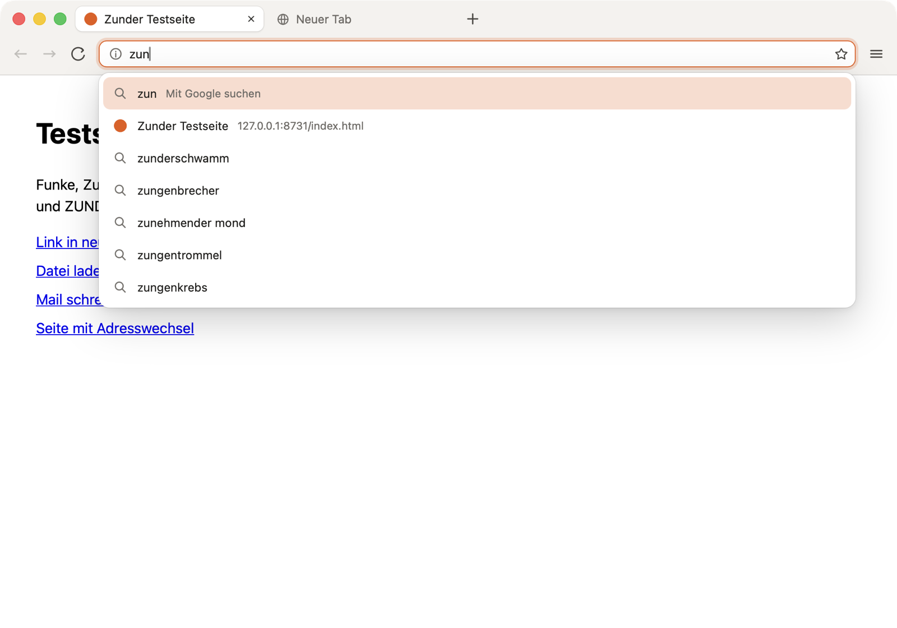
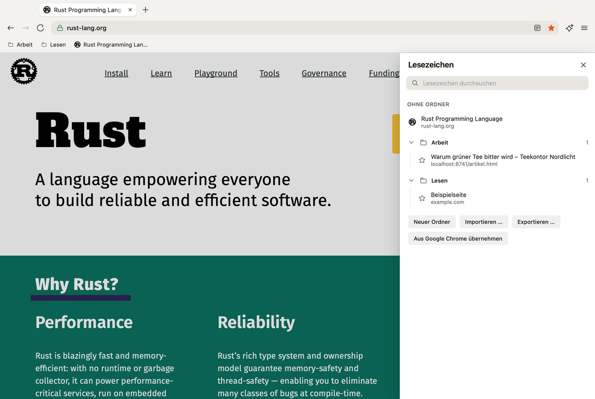
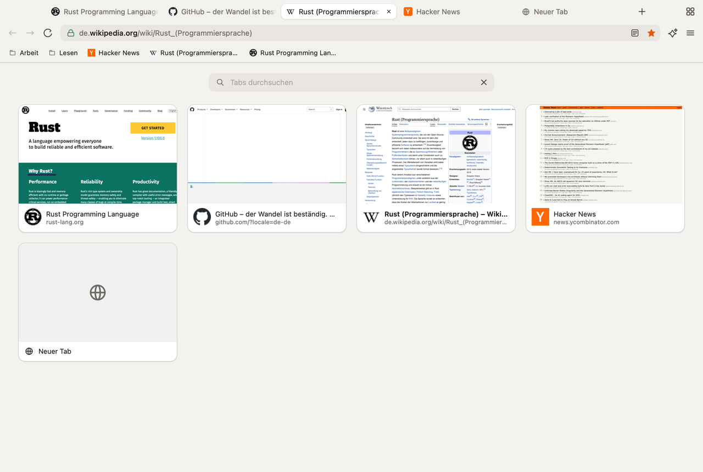
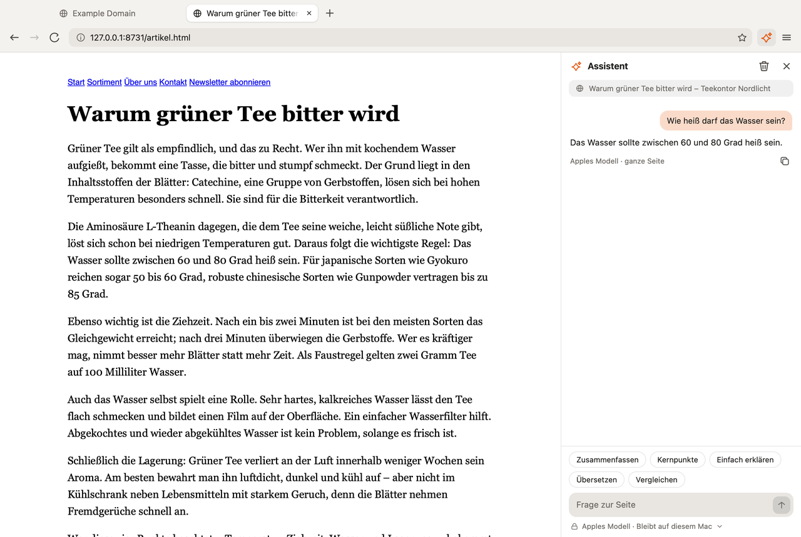
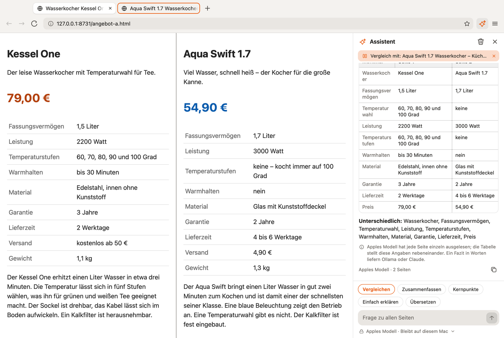
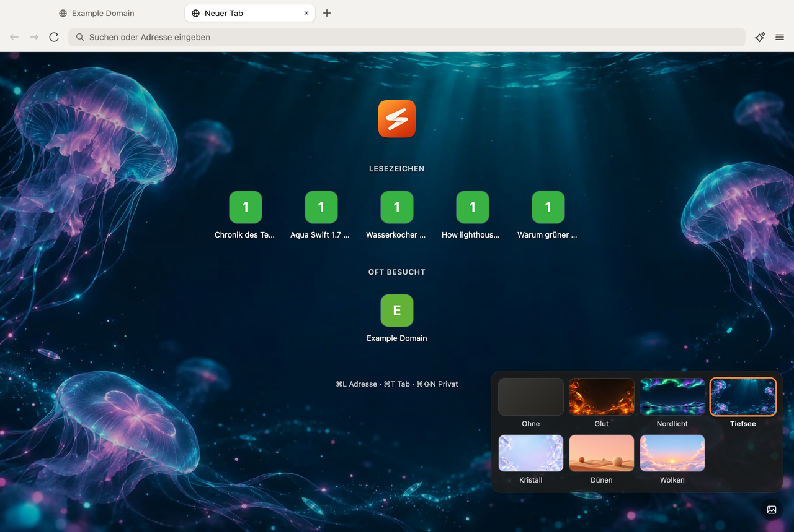
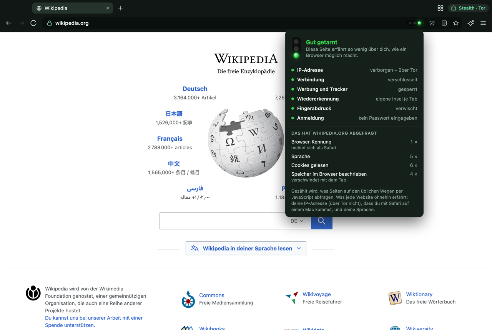
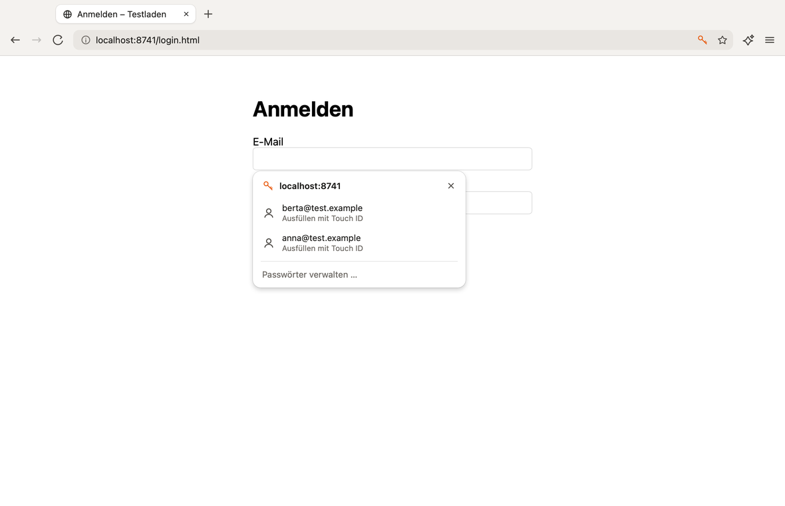
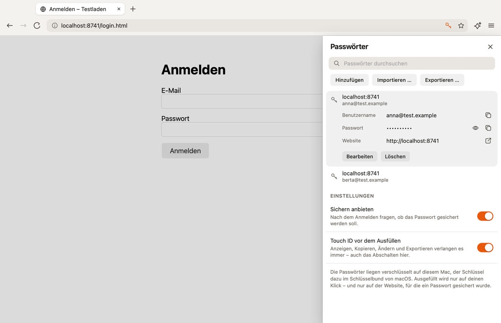
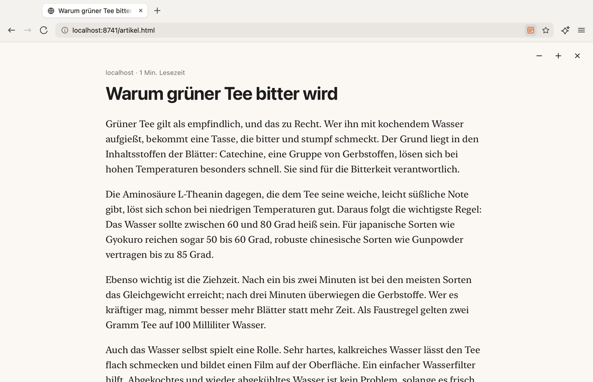

# Zunder

Ein schneller, schlichter Webbrowser für den Mac – mit eingebautem
KI-Assistenten, der auch ganz ohne Netz arbeitet.

Die gesamte Hülle ist in Rust geschrieben: Fenster, Tabs, Adressleiste,
Verlauf, Lesezeichen, Downloads, Privatmodus, Werbeblocker, Passwort-Tresor,
Assistent. Die Seiten selbst stellt das in macOS eingebaute WebKit dar – nicht
Chromium.
Damit läuft das heutige Web vollständig, und die App startet sofort.



## Was Zunder kann

- **Tabs**: öffnen, schließen, per Ziehen umsortieren, duplizieren,
  geschlossene wieder öffnen, ⌘1–⌘9, ⌃Tab. Links mit ⌘-Klick oder mittlerer
  Maustaste öffnen einen Tab im Hintergrund. **Tabs durchsuchen** (⇧⌘A) findet
  unter vielen offenen den richtigen; die Leiste rollt mit, sodass der aktive
  Tab immer zu sehen ist. **Alle Tabs zeigen** (⇧⌘\) legt sie als Karten mit
  Vorschaubild nebeneinander – durchsuchbar, mit einem Klick gewechselt oder
  geschlossen.
- **Adressleiste**: erkennt Adresse oder Suche, vervollständigt aus dem
  Verlauf, schlägt offene Tabs, Lesezeichen, Verlauf und Suchbegriffe vor.
  Sechs Suchmaschinen zur Wahl.
- **Verlauf, Lesezeichen, Downloads** als Seitenleisten, durchsuchbar.
- **Lesezeichen mit Ordnern**: ⌘D setzt eins; in der Seitenleiste lassen sie
  sich umbenennen, in Ordner legen und durch Ziehen sortieren. Die
  **Lesezeichenleiste** (⇧⌘B) zeigt sie unter der Adresszeile, Ordner als
  Aufklappmenü.
- **Startseite als Schreibtisch**: Lesezeichen liegen dort als Kacheln, die
  sich durch Ziehen anordnen und in Ordner legen lassen; ein Ordner öffnet
  sich als kleines Fenster. Dazu oft Besuchtes und auf Wunsch ein
  Live-Hintergrund.
- **Passwörter**: sichert Anmeldungen verschlüsselt, füllt sie auf einen Klick
  und nach Touch ID aus und schlägt sichere Passwörter vor – siehe unten.
- **Lesemodus** (⌥⌘R): zeigt nur den Text eines Artikels, ohne Menüs, Werbung
  und Randspalten. Schriftgröße wählbar, hell und dunkel nach System.
- **Umziehen**: Lesezeichen kommen direkt aus Chrome, Brave, Edge oder Vivaldi
  herüber oder aus der HTML-Datei, die Safari und Firefox exportieren;
  Passwörter aus der CSV-Datei jedes Browsers oder Passwortmanagers. Beides
  lässt sich auch wieder als Datei sichern.
- **Private Fenster**: kein Verlauf, keine Sitzung, keine Suchvorschläge;
  Cookies und Website-Daten leben nur, solange das Fenster offen ist.
- **Suche in der Seite** mit Trefferzählung, **Zoom** je Tab, **Drucken**.
- **Für Entwickler**: die vollständigen Entwicklerwerkzeuge von WebKit
  (Elemente, Konsole, Netzwerk, Quellen, Speicher; ⌥⌘I – von Haus aus
  abgeschaltet, der Menüpunkt schaltet sie ein), **Seitenquelltext** (⌥⌘U) so,
  wie der Server ihn liefert, und die **mobile Ansicht** (⇧⌘M): Der Tab gibt
  sich als iPhone aus, Seiten liefern ihre mobile Fassung.
- **Sitzung**: Beim Start sind die Tabs vom letzten Mal wieder da und laden
  erst, wenn man sie öffnet.
- **Speicher sparen**: Tabs, die drei Stunden unbenutzt im Hintergrund liegen,
  geben ihren Speicher frei – außer es läuft dort Ton oder Video.
- **Pop-ups und Anmeldefenster** werden zu Tabs und behalten die Verbindung
  zur öffnenden Seite.
- Dialoge der Seite, Anmeldung an geschützten Seiten, Fehlerseite mit
  „Erneut versuchen“, Rückfrage vor dem Öffnen anderer Programme.
- Hell und dunkel nach Systemeinstellung, Oberfläche deutsch oder englisch.
- **Ladebild beim Start**: fünf Sekunden Animation – das App-Symbol „zündet“
  vor der Glut-Szene der Live-Hintergründe, der Schriftzug setzt sich, ein
  Balken füllt sich. Die Seiten laden währenddessen schon; ein Klick oder ein
  Tastendruck gibt den Browser sofort frei (wer lostippt, landet in der
  Adressleiste). Abschaltbar in den Einstellungen.







Dazu vier Dinge, die Zunder von anderen Browsern abheben:

### Assistent (⌘J)



Eine Seitenleiste, die die angezeigte Seite liest: zusammenfassen (⇧⌘J),
Kernpunkte, einfach erklären, übersetzen – oder eine eigene Frage stellen. Ist
auf der Seite etwas markiert, geht es nur um diese Stelle. Jeder Tab hat seine
eigene Unterhaltung; sie liegt nur im Arbeitsspeicher.

Drei Modelle stehen zur Wahl („Modell wählen“ unten in der Leiste):

| Modell | Wo es läuft | Eigenheiten |
| --- | --- | --- |
| **Auf diesem Mac** | Apples Sprachmodell (ab macOS 26, Apple Intelligence) | Ohne Konto, ohne Netz, antwortet in 2–5 Sekunden. Liest höchstens gut 6000 Zeichen auf einmal: Lange Seiten liest es in bis zu acht Teilen, bei Fragen sucht es die passenden Abschnitte heraus. Die Antwort sagt jeweils dazu, wie viel gelesen wurde. |
| **Ollama** | ein Modell der eigenen Ollama-Installation | Bleibt auf dem Mac. Liest etwa 28 000 Zeichen auf einmal. |
| **Claude** | Claude-API von Anthropic (Opus 5.5, Sonnet 5.5 oder Haiku 5.5) | Am gründlichsten, liest bis 400 000 Zeichen. Der Seitentext wird dafür an Anthropic gesendet. Braucht einen eigenen API-Schlüssel; er liegt im Schlüsselbund von macOS. |

Ohne ausdrückliche Wahl arbeitet der Assistent nur mit Modellen auf dem Mac –
von selbst geht nie etwas ins Netz. In privaten Fenstern gilt das immer, auch
wenn sonst Claude gewählt ist. Die Zeile unter dem Eingabefeld zeigt jederzeit,
welches Modell antwortet und ob der Text den Mac verlässt.

Bei Claude ist für Opus und Sonnet der serverseitige Ersatz eingeschaltet:
Lehnt ein Schutzfilter eine Anfrage ab, übernimmt in derselben Anfrage ein
anderes Claude-Modell (`fallbacks: "default"`). Haiku kennt diesen Weg nicht.

### Compared Browsing (⌥⌘J)



Im Assistenten „Vergleichen“ wählen, bis zu drei weitere Tabs ankreuzen – die
KI stellt die Seiten in einer Tabelle gegenüber. Mit genau einem weiteren Tab
stehen beide Seiten dabei nebeneinander im Fenster. Solange der Vergleich
läuft, gehen auch freie Fragen an alle Seiten zugleich („Welches ist
günstiger?“). Zwei Tabs lassen sich auch ohne KI nebeneinanderstellen:
Rechtsklick auf einen Tab → „Neben aktuellem Tab zeigen“.

Apples kleines Modell verwechselt Seiten, sobald es mehrere zugleich vor sich
hat. Deshalb sieht es beim Vergleichen immer nur eine: Es nennt je Seite
Stichworte, füllt dann je Seite denselben Steckbrief aus, und die Tabelle setzt
Zunder selbst zusammen. Darunter steht nur, was sich nachprüfen lässt – welche
Merkmale sich unterscheiden und welche gleich sind. Ein Fazit in Worten
liefern Ollama und Claude.

### Live-Hintergründe



Sechs bewegte 3D-Szenen für die Startseite: Glut, Nordlicht, Tiefsee,
Kristall, Dünen, Wolken. Gewählt wird über den Knopf unten rechts auf der
Startseite oder in den Einstellungen. Jede Szene ist eine 7,4 Sekunden lange,
nahtlos wiederholte Schleife; das Standbild ist sofort da, das Video blendet
darüber ein. Es läuft nur, solange die Startseite wirklich zu sehen ist – nicht
in einem Tab im Hintergrund und nicht in einem verdeckten Fenster. Wer am Mac
„Bewegung reduzieren“ eingeschaltet hat, bekommt nur das Standbild. Private
Fenster zeigen keinen Hintergrund.

### Sicherheit


Wenige Schalter, die wirklich etwas bewirken (Einstellungen → Sicherheit):

- **Nur verschlüsselte Verbindungen** (an): Eine `http://`-Adresse wird zuerst
  verschlüsselt versucht. Geht das nicht – Zertifikatsfehler, keine Antwort
  binnen sechs Sekunden, Rückleitung ins Unverschlüsselte –, fragt Zunder nach,
  statt still unverschlüsselt zu laden. Die Zustimmung gilt je Rechner, bis
  Zunder beendet wird. Geräte im eigenen Netz (localhost, 192.168.x.x,
  `.local` …) sind ausgenommen.
- **Werbung und Tracker blockieren** (an): sperrt Werbung, Tracker und
  ungefragte Werbefenster nach den Filterlisten, die auch die bekannten
  Werbeblocker nutzen – siehe [Werbeblocker](#werbeblocker).
- **Tracking-Anhängsel entfernen** (an): `utm_…`, `fbclid`, `gclid` und rund
  30 weitere Kennungen fliegen aus jeder Adresse, bevor sie geladen wird.
- **Vor täuschend ähnlichen Adressen warnen** (an): Wer zum ersten Mal auf
  einer Adresse landet, die einer eigenen Seite zum Verwechseln ähnelt, wird
  vor dem Laden gefragt – `paypa1.com` statt `paypal.com`, kyrillische statt
  lateinischer Buchstaben, ein Tippfehler neben der Bank, oder die bekannte
  Adresse als Vorsatz einer fremden (`paypal.com.konto.example`). Verglichen
  wird nur mit dem, was der Browser selbst weiß: Lesezeichen, gesicherte
  Passwörter, eingetippte und besuchte Seiten. Nichts davon verlässt den Mac.
- **Eigenes Netz abschirmen** (an): Eine Website aus dem Internet darf weder
  den Router noch den Drucker noch einen Dienst auf diesem Mac ansprechen –
  nicht im Hintergrund (Bilder, Skripte, `fetch`, WebSockets, eingebettete
  Rahmen) und nicht, indem sie den Tab dorthin schickt. Versucht es eine
  Seite, sagt Zunder einmal Bescheid und bietet an, es ihr zu erlauben; die
  Erlaubnis steht in den Einstellungen und lässt sich dort zurücknehmen.
  Seiten, die selbst im eigenen Netz liegen, und Adressen, die man selbst
  eintippt, sind nicht betroffen.
- **Härtung** (aus): schaltet WebKits Lockdown-Modus für alle Tabs ein – ohne
  JIT, WebAssembly, WebGL und Webfonts. Der stärkste Schutz vor präparierten
  Seiten; manche Seiten werden langsamer oder sehen anders aus.
- **Entwicklerwerkzeuge** (aus): „Element untersuchen“ gibt es erst nach dem
  Einschalten. Solange es aus ist, kann auch kein anderes Programm über Safaris
  Entwicklerwerkzeuge in die Seiten hineinsehen.
- **Beim Beenden löschen** (aus): Verlauf, Cookies, Website-Daten,
  Zwischenspeicher und die Sitzung sind nach dem Beenden weg.


Immer aktiv und ohne Schalter:

- **Die Adressleiste zeigt, wem eine Seite gehört.** Der Teil der Adresse, der
  zählt (`example.com`), steht kräftig da und rutscht nie aus dem Bild – auch
  nicht hinter `konto.bank.de.irgendwas.example.com`. Zugangsdaten in der
  Adresse (`bank.de@fremd.example`) werden nicht angezeigt, Namen in fremden
  Schriften stehen in ihrer kodierten Form da.
- **Das Passwort einer Website auf einer anderen:** Tippt jemand ein
  gesichertes Passwort auf einer Seite ein, zu der es nicht gehört, warnt
  Zunder sofort – noch vor dem Abschicken, wenn man kurz innehält.
- **Andere Programme:** Eine Seite öffnet nie etwas ohne Rückfrage, und nur der
  Tab, den man vor sich hat. Netzlaufwerke, Fernzugriffe und Systemfunktionen
  (`smb:`, `ssh:`, `vnc:`, Kurzbefehle, Systemeinstellungen …) reicht Zunder
  aus einer Webseite heraus gar nicht weiter.
- **Dialoge** einer Seite nennen den Rahmen, der sie ausgelöst hat – nicht die
  Adresse, zu der die Seite gerade unterwegs ist. Tabs im Hintergrund zeigen
  keine; eine Seite, die damit nervt, lässt sich stummschalten, und das
  übersteht auch ihr Neuladen. Nach Benutzername und Passwort fragt nur die
  Seite selbst, nicht ein eingebundenes Bild von einem fremden Rechner.
- **Downloads** landen immer direkt im Download-Ordner, nie als versteckte
  Datei und nicht in Serie; macOS prüft sie vor dem ersten Öffnen. Private
  Fenster hinterlassen keine Zeile in der Download-Liste.
- **Vervollständigt** wird in der Adressleiste nur zu Seiten, die man schon
  einmal eingetippt oder als Lesezeichen gemerkt hat. Eine Seite, auf die man
  bloß geraten ist, kann sich nicht vordrängen.
- **Zunders Oberfläche lädt nichts aus dem Netz.** Seiten-Icons zeichnet ein
  Skript in der Seite selbst auf 32 × 32 Punkte; die Oberfläche bekommt nur
  dieses Bild. Keine Website erfährt so, wann jemand den Verlauf öffnet oder
  ihre Adresse tippt.
- Seiten laufen in den abgeschotteten Prozessen von WebKit, Pop-ups gehen nur
  nach einem Klick auf, Kamera und Mikrofon gibt es nur auf Nachfrage, das
  Profil ist nur für den eigenen Nutzer lesbar, und die App selbst ist mit
  „Hardened Runtime“ signiert.

**Der Browser selbst läuft in der Sandbox von macOS.** Nicht nur die Seiten
sind abgeschottet (das macht WebKit), auch das Programm darum herum – Fenster,
Verlauf, Passwort-Tresor, Assistent – kommt nur an sein eigenes Profil, an den
Download-Ordner und an Dateien, die man ihm im Dateidialog ausdrücklich gibt.
Der Rest des Benutzerordners ist für Zunder unerreichbar. Das Profil liegt
seitdem unter `~/Library/Containers/app.zunder.browser/`; ein Profil aus der
Zeit davor holt Zunder beim ersten Start einmal herüber (Cookies und
Anmeldungen bei Websites nicht – dort meldet man sich einmal neu an).


Stehen zwei Tabs nebeneinander, hat jede Hälfte ihre eigene Adresszeile – so
ist immer zu sehen, welche Seite wo steht, gleich, in welcher gerade
gearbeitet wird.

Grenzen, ehrlich benannt: Der Schutz des eigenen Netzes prüft die Adresse,
nicht, wohin ein Name am Ende zeigt – ein öffentlicher Name, der auf ein Gerät
im Heimnetz umgebogen wurde, fällt nicht auf. Die Warnung vor ähnlichen
Adressen kennt nur die eigenen Seiten, keine Liste bekannter Betrugsseiten.
Und alles, was WebKit selbst betrifft (Lücken in der Darstellung von Seiten),
schließt Apple mit den Updates von macOS – Zunder kann dort nur die
Angriffsfläche verkleinern (Härtung).

## Werbeblocker


Der Blocker ist von Haus aus an und arbeitet in zwei Schichten:

1. Eine **eingebaute Liste** der rund 180 bekanntesten Werbe- und
   Tracking-Dienste. Sie steckt im Programm und gilt vom ersten Abruf an.
2. Die großen Filterlisten **EasyList, EasyList Germany und EasyPrivacy** –
   zusammen rund 140.000 Regeln. Sie liegen der App bei (unverändert, siehe
   `assets/filters/`), werden alle vier Tage direkt von easylist.to
   aufgefrischt und von Zunder in das Regelformat von WebKit übersetzt
   (`src/filters.rs`). WebKit prüft die Abrufe dann selbst: Der Blocker liest
   keine Seite mit und kostet beim Surfen keine Zeit. Übersetzt wird nur, wenn
   sich die Listen ändern (rund sechs Sekunden im Hintergrund); beim Start
   stehen die Listen in weniger als einer Sekunde.

Gesperrt werden Abrufe (Skripte, Bilder, eingebettete Rahmen, Zählpixel …),
Werbefenster und einzelne Seiten, die sich ungefragt öffnen; ausgeblendet
werden die leeren Flächen, die Werbung sonst hinterlässt. Was sich in WebKits
Regelsprache nicht genau ausdrücken lässt (Skripte, Umleitungen, erweiterte
Auswahl-Sprachen), fällt weg – und zwar immer zur vorsichtigen Seite: Eine
Sperre wird höchstens enger, eine Ausnahme höchstens weiter als in der Liste.

- Das **Schild in der Adresszeile** zeigt, wie viele Abrufe auf der Seite
  gesperrt wurden. Ein Klick darauf schaltet den Blocker **nur für diese
  Website** ab oder an – für Seiten, die mit ihm nicht zurechtkommen.
- Manche Websites sperren Besucher mit Werbeblocker aus. Zunder umgeht solche
  Sperren nicht. Es sagt aber, woran es liegt, und bietet mit einem Klick an,
  den Blocker für genau diese Website abzuschalten.
- **Grenzen:** Werbung, die eine Website selbst und untrennbar vom Inhalt
  ausliefert (etwa Werbepausen in Videos), fängt ein Blocker dieser Bauart
  nicht ab. Dazu bräuchte es eingeschleuste Skripte – darauf verzichtet Zunder.

Die Listen stammen von den EasyList-Autoren (<https://easylist.to/>) und stehen
unter GPL v3 oder CC BY-SA 3.0; Näheres in `assets/filters/README.md`.

## Stealth-Fenster (⌥⌘N)


So wenig Spuren wie möglich – auf diesem Mac und im Netz. Ein Stealth-Fenster
ist ein privates Fenster mit zusätzlichen Riegeln:

- **Nichts bleibt auf dem Mac:** kein Verlauf, keine Cookies, kein
  Zwischenspeicher. Nur Downloads und ausdrücklich gesetzte Lesezeichen bleiben.
- **Jeder Tab ist eine Insel:** Jeder Tab hat seinen eigenen, flüchtigen
  Datenspeicher. Was eine Website in einem Tab speichert, sieht kein anderer –
  Websites erkennen niemanden von Tab zu Tab wieder. (Tabs, die eine Seite
  selbst öffnet, teilen sich die Insel ihrer Herkunft, sonst funktionierten
  Anmelde-Fenster nicht.)
- **Die Schutzschalter gelten immer:** Blocker, nur verschlüsselt, ohne
  Tracking-Anhängsel, Schutz des eigenen Netzes – gleich, was sonst
  eingestellt ist.
- **Der Fingerabdruck wird verwischt:** WebKits Lockdown-Modus (kein JIT,
  WebAssembly, WebGL), kein WebRTC (es spräche am Tunnel vorbei), und WebKits
  eigener Schutz gegen Fingerabdrücke: Was Seiten von einer Zeichenfläche
  zurücklesen, ist verrauscht – in jedem Tab anders –, und als Bildschirmgröße
  sehen sie die Größe des Fensters.
- **Über Tor, wenn Tor läuft:** Findet Zunder auf dem Mac einen Tor-Zugang
  (Port 9050 des Tor-Dienstes oder 9150 des Tor Browsers), geht der gesamte
  Verkehr des Fensters dort hindurch – jeder Tab über einen eigenen Weg, Namen
  werden erst im Tor-Netz aufgelöst. Fällt Tor aus, lädt nichts mehr: Am
  Tunnel vorbei geht nichts. Einrichten: `brew install tor && brew services
  start tor`, danach ein neues Stealth-Fenster öffnen.

Was es **nicht** kann, sagt die Startseite des Fensters offen: Ohne Tor sehen
Websites und Netzbetreiber weiterhin die IP-Adresse. Und auch mit Tor ist
Zunder nicht der Tor Browser – dessen Besucher sehen für Websites alle gleich
aus, die von Zunder nicht. Wer sich irgendwo anmeldet, ist dort erkennbar.

### Tarn-Ampel



In der Adresszeile eines Stealth-Fensters zeigt eine Ampel, wie gut man auf
der Seite getarnt ist, die gerade offen ist:

- **Grün:** über Tor, verschlüsselt, Blocker an, kein Passwort eingegeben.
- **Gelb:** Die Website sieht die IP-Adresse (Tor läuft nicht) – oder der
  Blocker ist für diese Website abgeschaltet.
- **Rot:** Die Verbindung ist unverschlüsselt – oder man hat auf dieser
  Website ein Passwort eingegeben und ist ihr damit bekannt.

Ein Klick zeigt die Gründe und dazu, **was die Seite selbst per JavaScript
abgefragt hat**: Bildschirmgröße, Zeichenfläche (typisch für Fingerabdrücke),
Grafikkarte, Geräte-Eigenschaften, Browser-Kennung, Sprache, Zeitzone,
Schriften, Cookies, Speicher, Standort, Kamera und Mikrofon, Zwischenablage –
jeweils mit Anzahl, auch für eingebettete Rahmen. Gezählt wird, was über die
üblichen Wege läuft (`ui/watch.js`); das ist eine Auskunft, kein Beweis: Eine
Seite, die es darauf anlegt, kann daran vorbei fragen.

## Passwörter



Nach einer Anmeldung fragt Zunder, ob es das Passwort sichern soll. Kommt man
wieder, zeigt sich am Anmeldefeld, was für diese Website gesichert ist: ein
Klick, Touch ID, ausgefüllt. In Feldern für ein neues Passwort schlägt Zunder
eines vor (18 zufällige Zeichen in drei Gruppen) und sichert es gleich mit.
Der Schlüssel in der Adressleiste zeigt dasselbe, ⇧⌘K füllt die zuletzt
benutzte Anmeldung aus, und „Passwörter“ im Menü öffnet die Verwaltung:
suchen, anzeigen, kopieren, ändern, löschen, importieren, exportieren.



Wie das abgesichert ist:

- **Verschlüsselt abgelegt.** Website und Benutzername stehen lesbar in der
  Datenbank, das Passwort nur verschlüsselt (ChaCha20-Poly1305) – gebunden an
  genau diese Website und diesen Namen. Der Schlüssel liegt im Schlüsselbund
  von macOS und wird erst geholt, wenn zum ersten Mal ein Passwort gebraucht
  wird.
- **Nur auf einen Klick.** Von selbst füllt Zunder nie etwas aus. Ein Skript
  einer Seite kommt so nicht an ein Passwort, solange niemand klickt. Auch die
  Vorschläge erscheinen erst, wenn jemand selbst in ein Feld geklickt oder
  eine Taste gedrückt hat – eine Seite kann sie nicht heraufbeschwören.
- **Nur auf derselben Website.** Ein Passwort geht nur dorthin, wofür es
  gesichert wurde (derselbe Rechnername, mit oder ohne „www.“, derselbe Port),
  und ein verschlüsselt gesichertes nie auf eine unverschlüsselte Seite. Die
  Entscheidung fällt im Dokument selbst, unmittelbar vor dem Einsetzen, an
  seiner wirklichen Herkunft; der Browser prüft vorher zusätzlich gegen die
  Adresse des Tabs. Das Passwort reist dabei als Argument in die Seite, nie
  als Text eines Skripts – so kann es auch in keiner Fehlermeldung landen.
- **Eingebettete Rahmen bekommen nichts.** Es zählt nur die Seite selbst, nicht
  was fremde Anbieter in ihr einblenden.
- **Die Seite redet nicht mit.** Erkennen und Ausfüllen erledigt ein Skript in
  einer eigenen, von der Seite abgeschotteten Welt. Die Skripte der Seite sehen
  weder seine Funktionen noch seinen Kanal zum Browser – sie können ihm keine
  Anmeldungen unterschieben und nicht abfragen, welche Konten gesichert sind.
- **Touch ID** (oder das Passwort des Macs) vor dem Ausfüllen. Das lässt sich
  abschalten – aber nur mit Touch ID, und vermerkt wird es beim Schlüssel im
  Schlüsselbund, nicht in einer Datei, die sich umschreiben ließe. In der
  Verwaltung braucht es die Abfrage vor dem Anzeigen, Kopieren und Ändern,
  vor jedem Exportieren eigens. Eine Freigabe zum Ausfüllen öffnet die
  Verwaltung nicht und umgekehrt.
- Ein kopiertes Passwort ist für Zwischenablage-Verwalter als geheim markiert
  und nach 90 Sekunden wieder aus der Zwischenablage verschwunden.
- **Private Fenster** füllen aus, sichern aber nichts.

## Lesemodus (⌥⌘R)



Wo eine Seite genug Fließtext hat, zeigt die Adressleiste den Knopf dafür. Der
Lesemodus sucht den Artikel, lässt Menüs, Werbung, Randspalten und Kommentare
weg und setzt den Text in ruhiger Schrift neu – mit Überschrift, Bildern,
Listen, Tabellen und Links. Schriftgröße über − und +, hell oder dunkel nach
System; Esc oder ein zweiter Klick auf den Knopf führt zurück zur Seite.

## Gemessen

Auf einem MacBook Pro (Apple Silicon, macOS 26) mit lokalen Testseiten:

| | |
| --- | --- |
| Größe der App | 15 MB – davon 10 MB die sechs Hintergründe |
| Fenster steht | nach etwa 0,15 s |
| erste Seite geladen | nach etwa 0,4 s |
| Last im Leerlauf | 0 % CPU, kein einziges Aufwachen |
| Zusammenfassung einer Seite, Apples Modell | 2–4 s |
| Vergleich zweier Seiten, Apples Modell | 4–5 s |
| lange Seite (64 000 Zeichen), Apples Modell | etwa 20 s für acht Teile |

## Was fehlt

- Erweiterungen, Synchronisierung zwischen Geräten, Profile.
- **Passkeys**: WebKit gibt sie eingebetteten Browsern nur mit einer
  Berechtigung frei, die Apple auf Antrag an Browser-Hersteller vergibt. In
  Zunder meldet WebKit deshalb „nicht verfügbar“; Seiten bieten dann den Weg
  über das Passwort an.
- Automatisches Ausfüllen von Adressen und Zahlungsdaten.
- Der Passwort-Tresor füllt keine Anmeldeformulare aus, die in einem
  eingebetteten Rahmen einer anderen Website stecken, warnt nicht vor
  Passwörtern aus bekannten Datenlecks und erkennt nicht jede Anmeldung: Nach
  dem Sichern fragt er, wenn die Seite nach dem Abschicken wechselt oder das
  Passwortfeld verschwindet – auch dann, wenn die Anmeldung abgelehnt wurde.
- Der Lesemodus findet den Artikel über einfache Regeln (wo steht der meiste
  Fließtext?). Auf Seiten, die ihren Text ungewöhnlich verpacken, fehlt
  mitunter etwas oder es bleibt Beiwerk stehen.
- Mitteilungen von Webseiten und Standortabfrage (bietet WebKit eingebetteten
  Browsern nicht bzw. nur mit Zusatzaufwand an).
- Der Blocker setzt die Filterlisten um, schleust aber keine Skripte in
  Seiten ein. Werbepausen in Videos und Websites, die Besucher mit Blocker
  aussperren, bleiben deshalb, wie sie sind.
- Stealth-Fenster: Tor bringt Zunder nicht selbst mit – es nutzt einen
  Tor-Zugang, der auf dem Mac läuft. Ohne ihn bleibt die IP-Adresse sichtbar.
- Der Assistent kennt Apples Modell auf dem Gerät, Ollama und Claude (mit
  API-Schlüssel). Andere Dienste und eine Anmeldung per OAuth gibt es nicht.
- **Sperrliste für Betrugsseiten**: WebKits eigener Schalter dafür ist an, ließ
  sich mit der offiziellen Testseite in Zunder aber nicht auslösen. Zugesagt
  wird dieser Schutz deshalb nicht. Zunder warnt selbst vor Adressen, die den
  eigenen Seiten täuschend ähneln, und beim Passwort am falschen Ort – eine
  Liste bekannter Betrugsseiten ersetzt das nicht.
- **Folgen der Sandbox**: Eine eingetippte Dateiadresse (`file://…`) öffnet
  Zunder nicht mehr – Dateien kommen über „Öffnen mit → Zunder“ herein, und
  dann nur die eine Datei, nicht ihre Nachbarn. Bei Links mit vorgegebenem
  Dateinamen (`download="…"`) heißt die Datei so, wie der Server sie nennt.
  „Aus Chrome übernehmen“ liest nur das Standardprofil.
- Lesezeichen kennen eine Ebene von Ordnern, keine Ordner in Ordnern.
- Die Vorschaubilder der Tab-Übersicht entstehen, während ein Tab vorn ist; ein
  Tab, der nie vorn war, zeigt sein Icon.
- Der Assistent liest nur Text: keine PDFs, keine Bilder, nichts aus
  eingebetteten Rahmen fremder Herkunft. Er kann im Browser nichts auslösen
  und nichts im Netz nachschlagen.
- Der Weg zu Claude ist gegen einen lokalen Nachbau des Dienstes geprüft
  (Anfrage, Antwortstrom, Fehlerfälle), nicht gegen den echten Dienst.
- Der API-Schlüssel und der Schlüssel des Passwort-Tresors hängen im
  Schlüsselbund an der Signatur der App. Weil die App nur lokal signiert ist,
  fragt macOS nach jedem Neubau einmal nach dem Passwort des Schlüsselbunds
  („Immer erlauben“ gilt bis zum nächsten Neubau).
- Wer am entsperrten Mac sitzt, kann ohne Touch ID Passwörter löschen und
  neue hinzufügen, aber keine lesen. Nach dem Ausfüllen steht ein Passwort im
  Feld der Seite – dort lässt es sich, wie in jedem Browser, sichtbar machen.
  Ein anderes Programm desselben Benutzers kann den Schlüssel im Schlüsselbund
  löschen (dann sind die Passwörter verloren), ohne Rückfrage von macOS aber
  nicht lesen.
- Tastenkürzel des Browsers haben Vorrang vor denen einer Seite.
- Gebaut für Apple Silicon. Für Intel-Macs müsste zusätzlich für
  `x86_64-apple-darwin` gebaut werden.

## Bauen und starten

Voraussetzung: Rust (stable) und die Xcode-Kommandozeilenwerkzeuge (für den
Swift-Helfer des Assistenten braucht es das SDK von macOS 26).

```bash
scripts/bundle.sh
```

Das Ergebnis liegt in `dist/Zunder.app`. Mit `scripts/bundle.sh --install`
landet die App zusätzlich in `/Applications` (Programme).

Die App ist nur lokal signiert. Das genügt für den eigenen Mac; zum
Weitergeben braucht es eine Apple-Entwickler-ID und Notarisierung.

Signiert wird mit „Hardened Runtime“ und für die Sandbox von macOS
(`assets/Zunder.entitlements`). `ZUNDER_SANDBOX=0 scripts/bundle.sh` baut ohne
Sandbox – dann liegt das Profil wieder unter
`~/Library/Application Support/Zunder`.

Lässt sich der Helfer nicht bauen (älteres Xcode), entsteht die App trotzdem;
der Assistent bietet dann Ollama und Claude an.

## Aufbau

| Datei | Aufgabe |
| --- | --- |
| `src/app.rs` | Zustand, Ereignisschleife, Fenster, Tabs, Nebeneinander, Sitzung |
| `src/commands.rs` | Befehle aus Oberfläche und Menüleiste, Einstellungen |
| `src/pages.rs` | Ereignisse aus den Seiten: Laden, Titel, Pop-ups, Downloads, Fehler |
| `src/webviews.rs` | Erzeugt die WebViews (Rahmen, Assistent, eine je Tab) |
| `src/native.rs` | Direkter Draht zu AppKit/WebKit für alles, was wry nicht anbietet |
| `src/omnibox.rs` | Adressleiste: Adresse oder Suche, Suchmaschinen, Vorschläge |
| `src/shield.rs` | Schutz beim Navigieren: nur verschlüsselt, Tracking-Anhängsel |
| `src/blocker.rs` | Werbeblocker und Schutz des eigenen Netzes: Regellisten für WebKit, Auffrischen, Schalter je Website |
| `src/filters.rs` | Übersetzer für Filterlisten (EasyList-Schreibweise → WebKits Regelformat) |
| `src/stealth.rs` | Stealth-Fenster: Tor-Zugang auf dem Mac finden |
| `src/vault.rs` | Passwort-Tresor: Verschlüsselung, Schlüssel, Zuordnung zu Websites, CSV |
| `src/logins.rs` | Passwörter im Browser: Sichern, Ausfüllen, Sprechblase, Verwaltung |
| `src/reader.rs` | Lesemodus |
| `src/bookmarks_io.rs` | Lesezeichen aus anderen Browsern übernehmen und sichern |
| `src/ai.rs` | Die drei Modelle hinter einer Schnittstelle; Zerlegen langer Seiten, Vergleich |
| `src/assistant.rs` | Seitenleiste des Assistenten: Seitentext holen, Modellwahl, Schlüssel |
| `src/wallpapers.rs` | Liefert die Live-Hintergründe an die Startseite |
| `src/store.rs` | Verlauf, Lesezeichen, Downloads, Einstellungen (SQLite) |
| `src/menu.rs` | Menüleiste |
| `src/assets.rs` | Liefert Oberfläche und interne Seiten über `zunder://` aus |
| `src/i18n.rs` | Texte, deutsch und englisch |
| `src/dev.rs` | Prüfhilfe – nur in Probe-Apps mit dem Bau-Merkmal `harness` |
| `helper/zunder-ai.swift` | Brücke zu Apples Sprachmodell (eigenes kleines Programm in der App) |
| `ui/` | Oberfläche (HTML, CSS, JavaScript), Assistent, Sprechblase, Startseite, Fehlerseite |
| `ui/logins.js`, `ui/reader.js` | Zunders eigene Skripte in den Seiten (abgeschottete Welt) |

Ein Fenster besteht aus einer WebView für den Rahmen (Tab-Leiste,
Adressleiste, Seitenleisten), einer WebView je Tab und – sobald sie zum ersten
Mal gebraucht werden – je einer für den Assistenten und für die Sprechblase
des Passwort-Tresors. Jede Seite läuft damit in eigenen WebKit-Prozessen,
getrennt vom Browser selbst.

Für Menüs, Vorschläge und Seitenleisten legt sich der durchsichtige Rahmen
kurz über das ganze Fenster; Suchleiste und Hinweise schieben die Seite
stattdessen nach unten, damit sie bedienbar bleibt. Der Assistent sitzt neben
der Seite und macht sie schmaler, statt sie zu verdecken. Die Sprechblase des
Passwort-Tresors ist eine eigene kleine Ansicht über der Seite: Sie verdeckt
nur ihre eigene Fläche, daneben bleibt die Seite bedienbar.

`wry` kennt nur „Seite übernommen“ und „Seite fertig“. Was ein Browser darüber
hinaus braucht – Ladebeginn, Weiterleitung, Ladefehler, Dialoge der Seite,
Anmeldeabfrage, ⌘-Klick, den Schutz beim Navigieren – rüstet `native.rs` zur
Laufzeit an den Delegate-Klassen von wry nach. Das ist die Stelle, die bei
einem Update von wry zuerst zu prüfen ist; in einer Probe-App zeigt der Befehl
`hooks`, was nachgerüstet wurde.

## Wie Zunder sich selbst schützt

- Die ausgelieferte App lässt sich nicht von außen steuern: Die Prüfhilfe
  (Befehle über die Standardeingabe, Umgebungsvariablen zum Prüfen) steckt nur
  in eigens gebauten Probe-Apps – siehe „Entwicklung“.
- Befehle nimmt der Browser nur von seiner eigenen Oberfläche an
  (`zunder://ui/`: Rahmen, Assistent und Sprechblase) – und von jeder Fläche
  nur, was zu ihrer Aufgabe gehört: Die Seitenleiste des Assistenten kommt
  nicht an Einstellungen oder Passwörter, die Sprechblase nur an ihre eigenen
  Antworten. Webseiten und auch die internen Seiten in einem Tab haben keinen
  Befehlskanal.
- Interne Seiten (`zunder://…`) lädt ein Tab nur, wenn der Browser selbst das
  will: Jede solche Navigation ist vorher angemeldet und gilt einmal. Eine
  Website kann deshalb weder die Fehlerseite mit eigenem Text und fremder
  Adresse aufrufen noch die Startseite oder die Oberfläche einbetten. Jede
  WebView bekommt außerdem nur ausgeliefert, was zu ihr gehört – ein Tab
  nichts von der Oberfläche, die Oberfläche keine Seiten für Tabs.
- Hält der Browser eine Navigation an, um sie zu verbessern (verschlüsselt
  statt unverschlüsselt, ohne Tracking-Anhängsel), geht die Seite danach
  selbst noch einmal los. So bleibt es ihre Navigation: Die Adressleiste zeigt
  bis zur Übernahme die alte Adresse, und Cookies, die nur bei eigenen Aufrufen
  mitgehen sollen, bleiben zu Hause.
- Was eine Seite dem Browser schickt, nimmt Zunder selbst entgegen und liest es
  Zeichen für Zeichen – ein kaputter Text (ein halbes Zeichenpaar) brachte die
  dafür übliche Bibliothek zum Absturz. Auch die Suche in der Seite und das
  Auslesen für den Assistenten laufen in Zunders abgeschotteter Welt und
  liefern nur Text zurück.
- Zunders eigene Skripte in einer Seite (Passwort-Tresor, Lesemodus) laufen in
  einer abgeschotteten Welt: Sie sehen dasselbe Dokument wie die Seite, aber
  die Skripte der Seite sehen weder ihre Funktionen noch ihren Kanal zum
  Browser. Zu jeder Meldung nennt WebKit selbst Rahmen und Herkunft; gewertet
  wird nur, was aus dem Hauptrahmen der Seite kommt, die der Tab gerade zeigt.
- Die Adressleiste zeigt eine Adresse, die noch lädt, nur dann, wenn der
  Browser selbst dorthin geschickt hat (Eingabe, Lesezeichen, neuer Tab).
  Schickt eine Seite sich woandershin, bleibt bis zur Übernahme die bisherige
  Adresse stehen – sonst stünde über ihrem Inhalt schon die fremde.
- Der Lesemodus baut den Artikel aus neu erzeugten Elementen im Dokument der
  Seite selbst nach – Text, Bilder und Links, nie HTML-Text der Seite, keine
  Skripte, keine Formulare. Eine eigene Seite unter Zunders Namen, die fremde
  Inhalte zeigt, entsteht dabei nicht.
- Die Sprechblase am Anmeldefeld erscheint dort, wo die Seite das Feld meldet.
  Das ist nur ein Hinweis: Die Blase nimmt Klicks erst einen Augenblick nach
  dem Erscheinen an, und ausgefüllt wird ohnehin nur auf der Website, für die
  ein Passwort gesichert wurde.
- Wenige eng begrenzte Meldungen dürfen Seiten schicken, und der Browser prüft
  jede gegen WebKits Angabe, woher sie kommt (nur der Hauptrahmen zählt): Die
  Startseite darf einen der eingebauten Hintergründe wählen, die
  Rückfrage-Seiten dürfen die Zustimmung melden („unverschlüsselt öffnen“,
  „trotz ähnlicher Adresse öffnen“, „dieser Website das eigene Netz erlauben“),
  und jede Seite darf sagen, dass sie die Tastatur bekommen hat (wirkt nur
  zwischen zwei nebeneinander gezeigten Tabs).
- Was von Webseiten kommt (Titel, Adressen), wird nur als Text eingesetzt,
  gekürzt und ohne Steuerzeichen. Ein Besuch zählt je Website höchstens alle
  30 Sekunden – eine Seite, die sich in Schleife neu lädt oder nur ihre Adresse
  ändert, schiebt sich weder in Vorschlägen noch auf der Startseite nach vorn.
- Der Assistent behandelt Seitentext als Material, nicht als Auftrag: Er steht
  in einer eigenen Klammer, die der Text selbst nicht schließen kann, und die
  Anweisung an das Modell sagt das ausdrücklich. Antworten werden als Text
  dargestellt – ohne Links, Bilder oder HTML – und der Assistent hat keine
  Werkzeuge. Was eine Seite dem Modell unterschiebt, kann deshalb nichts
  auslösen und nichts nachladen. Titel und Adresse einer Seite nimmt der
  Browser aus dem Tab, nicht aus der Seite.
- Andere Programme (`mailto:`, `tel:` …) öffnet eine Seite nie ohne Rückfrage;
  eingebettete Rahmen und Tabs im Hintergrund dürfen gar nicht erst fragen.
- Der Schlüssel für Claude geht an genau eine Adresse – keiner Umleitung nach,
  nie unverschlüsselt. Über Ollama nutzt der Assistent nur Modelle, die auf
  diesem Mac laufen; solche, die Ollama in der Cloud rechnen lässt, bietet er
  nicht an. Eine Frage gilt genau der Seite, zu der sie gestellt wurde: Hat der
  Tab inzwischen gewechselt, geht nichts an ein Modell.
- Private Fenster nutzen einen flüchtigen Datenspeicher; Verlauf, Sitzung,
  Suchvorschläge und Modelle im Netz bleiben dort aus.
- Suchvorschläge senden die Eingabe an die gewählte Suchmaschine (abschaltbar
  in den Einstellungen). Adressen werden dabei nie gesendet.

## Icons und Hintergründe

Alle Icons wurden über Higgsfield generiert (Modell `gpt_image_2_6`): das
App-Icon als Bild, die 50 Icons der Oberfläche als SVG. Die unveränderten
Ergebnisse liegen in `assets/higgsfield-raw/`, die Auftragsnummern in
`assets/icon-jobs.json`.


```bash
python3 -I scripts/build_icons.py /tmp/zunder-icons
```

bereitet sie auf: Die SVGs werden auf eine feste Liste von Formen reduziert,
auf einheitliche Größe und Strichstärke gebracht und zu `ui/icons.svg`
zusammengefasst; aus dem Motiv entsteht `assets/Zunder.icns`.

Auch die Live-Hintergründe stammen von Higgsfield: das Standbild von
`gpt_image_2_6`, die Bewegung von `wan3_0` – mit dem Standbild als erstem und
letztem Bild, damit sich die Szene wiederholen lässt.


```bash
scripts/build_wallpapers.sh
```

macht aus den Rohfassungen (je 12–23 MB) nahtlose Schleifen von 1–2,5 MB samt
Standbild und Vorschau in `assets/wallpapers/`. Das braucht `ffmpeg`; die App
selbst braucht es nicht.

## Entwicklung

Geprüft wird an einer **Probe-App mit Prüfhilfe**. Sie entsteht nur auf
ausdrücklichen Wunsch und nur mit eigener Kennung:

```bash
ZUNDER_HARNESS=1 ZUNDER_BUNDLE_ID=app.zunder.browser.test ZUNDER_DIST=/tmp/zunder-probe scripts/bundle.sh
```

Eine Probe-App entsteht ohne Sandbox, weil die Prüfhilfe mit Ordnern außerhalb
arbeitet; `ZUNDER_SANDBOX=1` baut sie mit – dann ohne `ZUNDER_PROFILE_DIR` und
`ZUNDER_DOWNLOAD_DIR` starten.

Die Prüfhilfe ist ein eigenes Bau-Merkmal (`harness`, siehe `src/dev.rs`). Die
gewöhnliche App enthält sie nicht und wertet keine der folgenden Variablen aus
– sonst könnte jedes Programm, das Zunder starten darf, den Browser von außen
fernsteuern und etwa die Abfrage per Touch ID umgehen. Die eigene Kennung
braucht es, weil macOS Cookies und Website-Daten je Kennung ablegt: Ohne sie
teilte sich die Probe-App diese mit der echten App, und „Browserdaten löschen“
im Test träfe die echten Anmeldungen. Eine Probe-App benutzt außerdem immer
eigene Einträge im Schlüsselbund (`app.zunder.browser.test`) und, wenn nichts
anderes gesagt ist, ein eigenes Profil („Zunder-Probe“).

In der Probe-App gilt:

- `ZUNDER_PROFILE_DIR=<ordner>` nutzt ein eigenes Profil,
  `ZUNDER_DOWNLOAD_DIR=<ordner>` einen eigenen Download-Ordner,
  `ZUNDER_UI_DIR=ui` lädt die Oberfläche frisch von der Platte.
- `ZUNDER_DEBUG=1` nimmt Befehle über die Standardeingabe an: `dump` (Zustand
  als JSON), `menu <id>`, `ui <json>`, `js <code>`, `jsin <tab-nr> <code>`,
  `uijs <code>`, `aijs <code>` (im Assistenten), `bubjs <code>` (in der
  Sprechblase), `isojs <code>` (in Zunders abgeschotteter Welt der Seite),
  `snap <ordner>` (Bilder von Rahmen, Seiten, Assistent und Sprechblase),
  `filechosen <zweck> <pfad>` (als wäre im Dateidialog gewählt worden),
  `hooks`, `lights`, `appearance dark|light`, `sleep <ms>`. Damit lässt sich
  der Browser ohne Maus und Tastatur durchprüfen.
- Mit `ZUNDER_DEBUG` richten `ZUNDER_CLAUDE_URL` und `ZUNDER_CLAUDE_KEY` den
  Claude-Weg auf einen Nachbau, `ZUNDER_OLLAMA_URL` auf eine andere
  Ollama-Adresse, `ZUNDER_AI_HELPER` auf einen anderen Helfer.
- Mit `ZUNDER_DEBUG`, für den Passwort-Tresor: `ZUNDER_AUTH=ok` bzw. `deny`
  beantwortet die Abfrage per Touch ID, `ZUNDER_VAULT_KEY=<64 Hex-Zeichen>`
  ersetzt den Schlüssel aus dem Schlüsselbund, `ZUNDER_PASTEBOARD=<name>` nimmt
  statt der echten eine eigene Zwischenablage, und
  `ZUNDER_IMPORT_ROOT=<ordner>` steht für den Ort, an dem andere Browser ihre
  Lesezeichen ablegen. So fasst ein Probelauf weder die Zwischenablage noch
  fremde Browserdaten an.

`cargo test` prüft die Deutung von Eingaben in der Adressleiste, die
Datenhaltung, die Sperrliste, den Schutz beim Navigieren, das Zerlegen und
Verpacken von Seitentext, die Form der Anfragen an die Modelle, das Ausliefern
der Hintergründe, den Passwort-Tresor (Zuordnung zu Websites, Verschlüsselung,
Vorschläge, CSV), das Einlesen von Lesezeichen, den Übersetzer für
Filterlisten – auch mit den mitgelieferten Listen als Ganzes – und das Erkennen
eines Tor-Zugangs (65 Tests).

Der Name „Zunder“ ist ein Arbeitstitel. Er steht in `Cargo.toml`,
`scripts/bundle.sh`, `src/menu.rs`, `src/i18n.rs` und im Schema `zunder://`.
